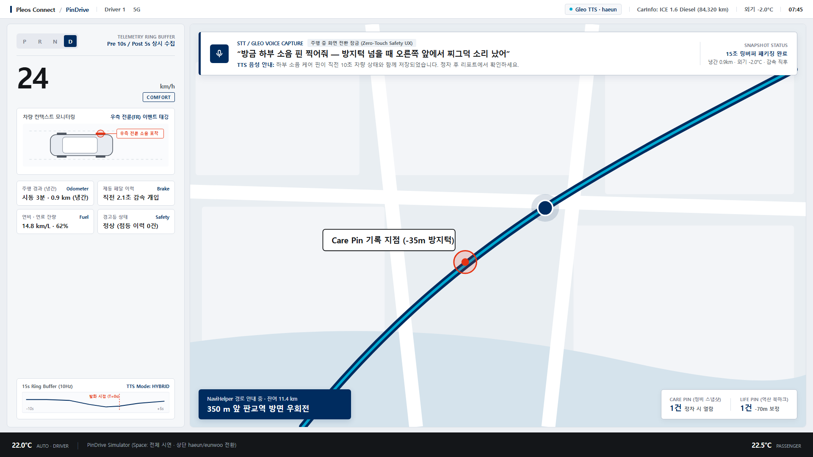
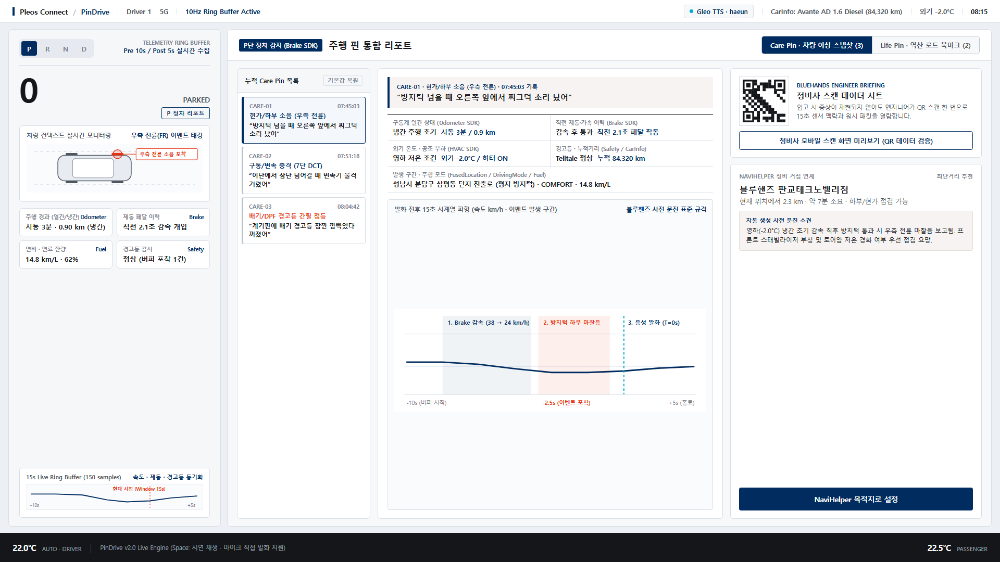
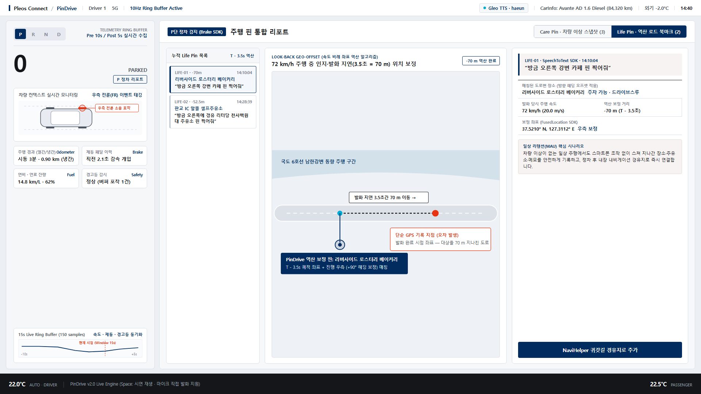
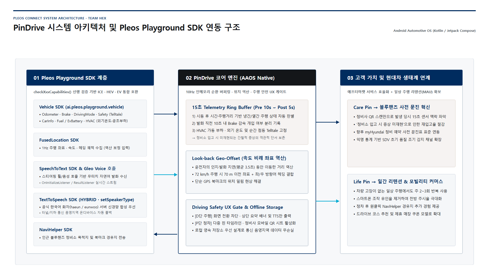

# PinDrive (핀드라이브)

> **“방금 그 하부 소음도, 스쳐 지나간 그 장소도, 한마디면 차의 상태와 함께 박제됩니다.”**  
> 운전 중 터치 제로(Zero-Touch) 음성 명령으로 **15초 차량 텔레메트리 스냅샷(`Care Pin`)**과 **속도 비례 역산 로드 북마크(`Life Pin`)**를 기록하고, 정차 순간 **정비사 브리핑 QR**과 **내장 내비게이션(`NaviHelper`)**으로 연결하는 **Pleos Connect 전용 인카(In-Car) 블랙박스 북마커**

- **Team Identifier**: `HEX` *(블라인드 심사 원칙에 따라 개발자 실명·소속·개인 연락처 미기재)*
- **Target Platform**: Hyundai Motor Group **Pleos Connect** (Android Automotive OS / API 29+)
- **Release APK**: [`apk/HEX_PinDrive_release.apk`](./apk/HEX_PinDrive_release.apk) *(또는 [GitHub Releases `v1.0.0`](https://github.com/HEX-HD/PinDrive/releases/tag/v1.0.0))*
- **Live Web Simulator (1920×1080 즉시 체험)**: [https://hex-hd.github.io/PinDrive/](https://hex-hd.github.io/PinDrive/)
- **Demo Video (시연 영상)**: [Google Drive 시연 영상 보기](https://drive.google.com/file/d/10eI4YSAQuMbOj9dQ1PfHge1fO3Y8mzk6/view?usp=sharing)

---

## 1. 주요 화면 미리보기 (Pleos Connect 1920×1080)

### [D단 주행 모드] 화면 전환 없는 무터치 음성 핀 포착 (Zero-Touch Safety UX)


### [P단 정차 모드 1] Care Pin — 15초 차량 상태 스냅샷 & 블루핸즈 3초 스캔 QR 리포트


### [P단 정차 모드 2] Life Pin — 3.5초 인지·발화 지연 거리(70m) 역산 보정 북마커


### 시스템 아키텍처 및 Pleos Playground SDK 파이프라인


---

## 2. 핵심 기능 요약

1. **Care Pin (15초 텔레메트리 순환 링버퍼 스냅샷)**
   - 발화 직전 10초 ~ 직후 5초간의 차량 데이터를 인메모리 순환 버퍼(`PinDriveEngine`)에서 추출하여 간헐적 소음·진동·경고등 발생 당시 맥락을 보존합니다.
   - **4대 정비 컨텍스트 자동 태깅**: ① 냉간/열간 주행 초기 여부(`Odometer`), ② 직전 제동 페달 개입 유무(`Brake`), ③ 외기 온도 및 공조 부하(`HVAC`), ④ 순간 점등 후 소멸된 경고등(`Safety`).
2. **Life Pin (속도 비례 좌표 역산 알고리즘 — Look-back Geo-Offset)**
   - 운전자가 도로변 매장을 보고 말하기까지 걸리는 평균 `3.5초` 동안 이동한 거리(예: `72km/h` 주행 시 `70m`)를 `FusedLocation` 궤적에서 역산하고 좌/우 방향어 헤딩 오프셋을 결합해 정확한 POI를 북마크합니다.
3. **주행/정차 완벽 분리 안전 인터페이스**
   - **주행 중(`D`)**: 화면 전환 금지, 비간섭 토스트 및 `TextToSpeech (HYBRID)` 음성 응답만 출력
   - **정차 시(`P`)**: 대화면 리포트 활성화, 정비사 브리핑용 QR 생성, `NaviHelper` 목적지/경유지 원클릭 전송

---

## 3. Pleos Playground SDK 활용 구조

| 도메인 / SDK | 패키지 | 활용 역할 |
| :--- | :--- | :--- |
| **Vehicle SDK** | `ai.pleos.playground.vehicle.api` | `Odometer`(누적/트립 주행거리), `Brake`(제동 개입·정차 감지), `DrivingMode`, `Safety`(Telltale), `CarInfo`, `Fuel`/`EvBattery`(`checkXxxCapabilities` 분기), `HVAC`(외기·공조 부하) |
| **FusedLocation SDK** | `ai.pleos.playground.location.fused` | 1Hz 주행 궤적 버퍼링 및 3.5초 전 속도 비례 좌표 역산 |
| **SpeechToText & Gleo AI** | `ai.pleos.playground.stt` | 무터치 자연어 음성 인식 및 `Care Pin` / `Life Pin` 의도 분류 |
| **TextToSpeech SDK** | `ai.pleos.playground.tts` | `HYBRID` 모드(음영지역 온디바이스 폴백) 청각 피드백 |
| **NaviHelper SDK** | `ai.pleos.playground.navi.helper` | 인근 블루핸즈 정비소 목적지 및 `Life Pin` 북마크 경유지 등록 |

---

## 4. 실행 방법 (How to Run)

### 방법 A. Release APK 바로 설치 및 실행 (권장)
1. 저장소의 [`apk/HEX_PinDrive_release.apk`](./apk/HEX_PinDrive_release.apk) 또는 **Releases (`v1.0.0`)** 에서 APK를 다운로드합니다.
2. Pleos Connect AAOS 에뮬레이터 또는 Android 10(API 29) 이상 태블릿·스마트폰에 설치합니다.
   ```bash
   adb install -r apk/HEX_PinDrive_release.apk
   ```
3. 앱 실행 후 좌측 패널의 **`Care Pin 음성 발화`**, **`Life Pin 음성 발화 (-70m)`** 버튼으로 주행 중 무터치 캡처와 TTS 응답을 확인하고, **`P단 정차 전환`** 버튼을 눌러 정비 스냅샷 QR 리포트 및 내비게이션 연동 동작을 확인합니다.

### 방법 B. 대화면 웹 인터랙티브 시뮬레이터 실행 (설치 불필요)
- `docs/index.html` 파일을 Chrome / Edge 브라우저(1920×1080 전체화면 권장)에서 열면 `Space` 키 하나로 **40초 전체 시나리오 자동 시연**을 즉시 확인할 수 있습니다.

### 방법 C. 소스코드 빌드 및 유닛 테스트 실행
- JDK 17 및 Gradle 8.9 환경에서 아래 명령으로 핵심 엔진 테스트(`PinDriveEngineTest`) 및 APK 빌드가 가능합니다.
  ```bash
  gradle test assembleRelease
  ```
